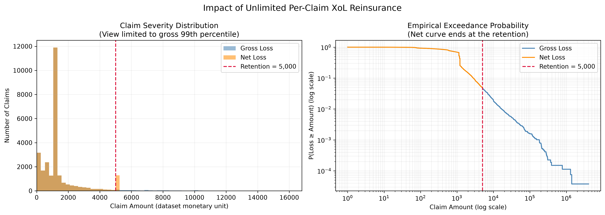

# Per-Claim Excess-of-Loss Reinsurance Analysis on French MTPL Claims

An empirical analysis of how an **unlimited per-claim excess-of-loss (XoL) reinsurance** contract changes the severity profile of motor third-party-liability claims, using the public `freMTPL2sev` dataset.



## Problem

Claim severities in motor liability insurance are heavily right-skewed: a few very large claims dominate total loss. This project asks:

- How much loss would an insurer cede at different retention levels (2,500 / 5,000 / 10,000)?
- How much does retained claim volatility fall?
- Which reported "risk reductions" carry real information, and which are artifacts of capping the loss?
- How reliable are the estimates, given how few extreme claims drive them?

## Data

- **Dataset:** `freMTPL2sev` (OpenML ID 41215), 26,639 claim amounts on 24,950 policies. Columns: `IDpol`, `ClaimAmount`.
- **Origin:** French motor third-party liability data from the `CASdatasets` R package (Dutang & Charpentier), published on OpenML.
- **License:** Public Domain (CC0), as stated on the OpenML dataset page.
- **Monetary unit:** as in the source data (not specified there).

The notebook reads `freMTPL2sev.csv` if it is present in the working directory and otherwise downloads the data from OpenML.

## Method

For a claim `X` and retention `R`:

- Net (retained) loss: `min(X, R)`
- Ceded loss: `max(X - R, 0)`, with the check `Gross = Net + Ceded`

Metrics: mean, standard deviation, empirical VaR (90/95/99%), empirical Expected Shortfall (fractional tail weighting), ceded share, number of triggering claims, average ceded amount per triggering claim, and the share of ceded loss coming from the single largest claim. Uncertainty is quantified with a nonparametric bootstrap (1,000 resamples, 95% percentile intervals).

## Key Results

| Retention | Claims triggering cover | Ceded share of total loss | 95% bootstrap CI | Net std. dev. |
|---|---|---|---|---|
| 2,500 | 3,102 (11.64%) | 49.13% | 41.74% – 57.22% | 680.65 |
| 5,000 | 1,250 (4.69%) | 41.15% | 32.69% – 50.39% | 1,143.19 |
| 10,000 | 485 (1.82%) | 34.54% | 25.21% – 44.59% | 1,740.25 |

Gross severity: mean 2,278.54, median 1,172, standard deviation 29,297.48, maximum 4,075,400.56. The largest 1% of claims make up 37.9% of total loss.

Main findings:

1. **A 5,000 retention cedes 41.15% of total loss through only 4.69% of claims**, and cuts the standard deviation of retained claims by 96.10% (29,297.48 to 1,143.19).
2. **Several headline reductions are mechanical.** Net VaR 99%, ES 99% and the maximum equal the retention by construction, because more than 1% of claims exceed it. Their reductions (70.23%, 94.22%, 99.88%) reflect the cap, not reinsurance effectiveness, and are flagged as such in the notebook.
3. **Estimates are uncertain and tail-driven.** The ceded share at 5,000 has a 95% interval of roughly 33%–50%, and the single largest claim accounts for 16.30% of ceded loss.
4. **Trade-off, not an optimum.** Raising the retention from 2,500 to 10,000 lowers the ceded share (49.13% to 34.54%) but increases retained volatility (std. dev. 680.65 to 1,740.25).

## Limitations

- The data contain claim severity only: no frequency, exposure or time, so annual aggregate risk cannot be assessed.
- Cover is assumed unlimited and claims are treated as independent; there is no event identifier, so claims on the same policy are not merged into events.
- Reinsurance premiums, cost of capital and counterparty risk are excluded, so no optimal retention is identified.
- About 42% of claims take one of only five amounts, which suggests standardised settlements and makes the body of the distribution discrete.

## Possible Extensions

- Merge with `freMTPL2freq` to estimate annual aggregate loss and layer burning cost per policy-year.
- Fit a tail model (e.g., Generalised Pareto above a threshold) to stabilise high-layer estimates.
- Evaluate limited layers and reinstatements; add reinsurance premium loadings.

## How to Run

```bash
git clone <your-repo-url>
cd <your-repo-folder>
python -m venv .venv
source .venv/bin/activate        # Windows: .venv\Scripts\activate
pip install -r requirements.txt
jupyter notebook xol_reinsurance_analysis.ipynb
```

Run all cells in order (Kernel > Restart & Run All). The notebook writes `xol_scenarios.csv`, `xol_risk_comparison.csv`, `xol_claim_allocation.csv` and `xol_loss_distribution.png` to the working directory.

## Repository Structure

```
.
├── README.md
├── requirements.txt
├── .gitignore
├── xol_reinsurance_analysis.ipynb
├── freMTPL2sev.csv            # CC0 data (optional; downloaded from OpenML if absent)
└── images/
    └── xol_loss_distribution.png
```

## Data Source and Credit

Dutang, C. and Charpentier, A., `CASdatasets` (French motor third-party liability data, `freMTPL2sev`). OpenML dataset 41215: https://www.openml.org/d/41215